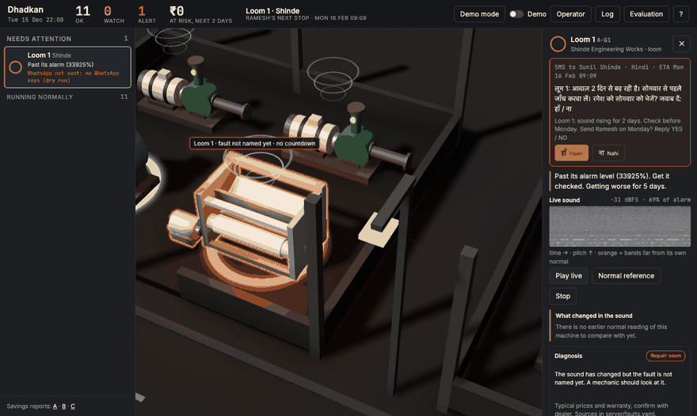
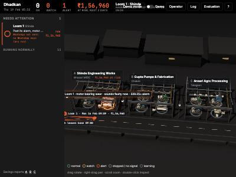
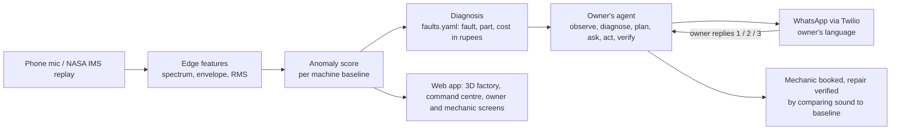
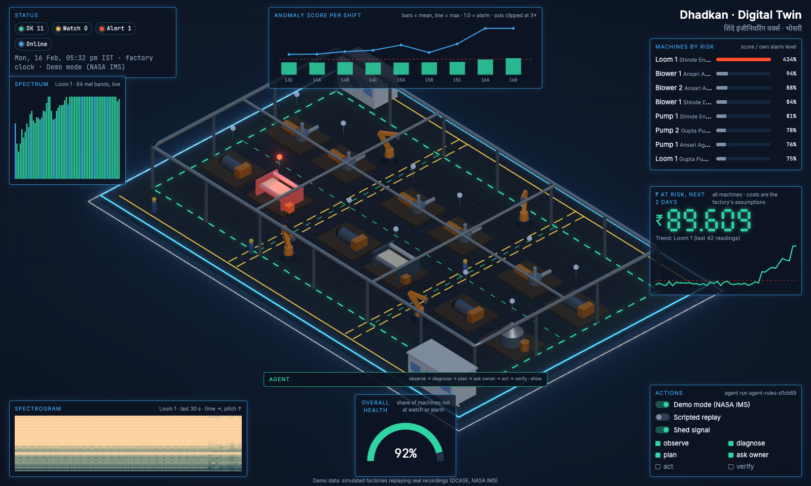
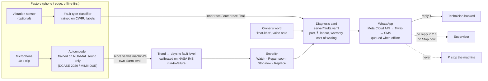
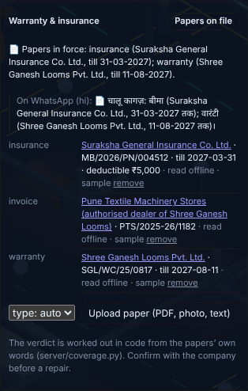

# Dhadkan

**Small Indian factories (powerlooms, flour mills, pumps) run old machines until they break. Dhadkan
uses a phone to hear failures coming, tells the owner on WhatsApp in their language, gets the right
repair done, and proves it worked.**

Monitoring exists for big plants with costly sensors. Nothing serves a small shed with a phone, in
the owner's language, and nothing checks that the repair actually worked.



*60 seconds of `make demo` → **Demo mode**. The fault that grows is a real bearing failing on the
NASA IMS test rig, not a simulation. Regenerate the GIF with `python -m tools.demo_gif`.*

Built for Tech4Bharat problem statement 4.3 (machine failure prediction for small factories).



## Contents

[Run it from GitHub](#run-it-from-github-step-by-step) · [Architecture](#architecture) · [Features](#features-factory-screen-digital-twin-and-the-owners-agent) · [How it works](#how-it-works) · [Run it](#run-it) · [Results](#results) · [Limits](#what-doesnt-work-yet) · [Submission](SUBMISSION.md)

## Run it from GitHub, step by step

Tested on macOS and Linux (on Windows, use WSL). You need **git**, **Python 3.12**, **Node.js 20 or newer**
with npm, and **make**. About 2 GB of disk space and an internet connection for the first setup.

**1. Get the code**

```bash
git clone https://github.com/Yojan-ui/dhadkan.git
cd dhadkan
```

**2. Install everything (once, several minutes)**

```bash
make setup             # creates .venv with Python 3.12, installs Python packages, then the web app (npm ci)
```

If your default `python3` is not 3.12, point at it: `make setup PYTHON=/path/to/python3.12`. With conda:
`conda create -y -n py312 python=3.12 && conda activate py312 && make setup PYTHON="$(which python)"`.

**3. Download the demo sound clips (once, about 200 MB)**

```bash
make demo-data         # the real machine recordings the factory screen replays (DCASE 2020 / MIMII, from zenodo.org)
```

The trained models and the NASA IMS bearing replay are already in the repo, but the factory screen also
replays these clips for the other machines, so `npm run demo` needs them.

**4. (Optional) WhatsApp keys**

Without keys everything still runs: each message is built, logged and shown as **dry run**. To get real
WhatsApp alerts on your phone through the Twilio sandbox:

```bash
cp .env.example .env
```

Then fill in `.env`:

| key | where to get it |
|---|---|
| `TWILIO_SID`, `TWILIO_TOKEN` | Twilio Console home page |
| `TWILIO_WA_FROM` | the sandbox "From" number on Twilio's *Try WhatsApp* page, e.g. `whatsapp:+14155238886` |
| `OWNER_PHONE` | your phone as `whatsapp:+91XXXXXXXXXX`; first send the sandbox `join ...` code from it |
| `NGROK_AUTHTOKEN` | optional, from ngrok.com: opens a public URL so your WhatsApp replies (1 / 2 / 3) reach the demo |
| `ANTHROPIC_API_KEY` | optional: lets Claude read photos and PDFs of papers and answer free-text questions; rules are used without it |

With `NGROK_AUTHTOKEN` set, the demo prints a URL. Paste `<that URL>/whatsapp/twilio` (method POST) into
Twilio's sandbox setting *When a message comes in*.

**5. Start the demo**

```bash
npm run demo           # builds the web app, starts the server on port 8600 and opens the browser
```

Open **http://127.0.0.1:8600** if the browser does not open by itself. You will see the factory screen.
Press **Start Demo mode**: Loom 1 replays a real bearing that failed on the NASA IMS test rig, its health
score climbs, the diagnosis card opens, and the WhatsApp alerts go out (or show as dry run). Reply **1** to
book the mechanic. Click Loom 1 to see its **Warranty & insurance** papers and whether this repair is
claimable; the owner screen (`?view=owner&f=A&lang=hi`) has a **Claim help** button with the steps and a
claim letter.

Other screens on the same server:

| URL | what it shows |
|---|---|
| `http://127.0.0.1:8600/` | factory screen (3D floor, needs attention, Demo mode) |
| `http://127.0.0.1:8600/?view=cc` | command centre: all machines, agents, jobs, parts |
| `http://127.0.0.1:8600/?view=owner&f=A&lang=hi` | the owner's phone screen in Hindi |
| `http://127.0.0.1:8600/?view=mechanic&f=A` | the mechanic's phone screen |
| `http://127.0.0.1:8600/?view=mill` | the flour-mill story, step by step |

Click any machine for its side panel: health, live spectrogram, 14-day trend, diagnosis, and the
**Warranty & insurance** papers (sample papers are loaded for Loom 1 and Pump 1; you can upload your own).

**6. Run the tests**

```bash
make test              # Python tests (pytest) and the web app tests
```

**If something goes wrong**

| message | fix |
|---|---|
| `.venv/bin/python: No such file or directory` | run `make setup` first |
| `Python 3.12+ needed` | install Python 3.12 and pass it: `make setup PYTHON=/path/to/python3.12` |
| `KeyError: 'pump/id_00'` | the demo clips are missing: run `make demo-data` |
| `port 8600 is already taken` | stop the other copy, or run `make demo-ims PORT=8700` |
| WhatsApp shows "dry run" | no keys in `.env`; see step 4 |
| no WhatsApp message arrives | send "hi" to the sandbox number first (it only delivers within 24 h of your last message) and check `OWNER_PHONE` |

## Architecture



## Features: factory screen, digital twin and the owner's agent

```bash
npm run demo      # backend + web app; the NASA IMS bearing run-to-failure plays as Loom 1 and the agent acts
```



- **Isometric factory floor** (React Three Fiber, orthographic camera at 45° / 35°): three bays of
  machines on pallets, overhead rails, robot arms, cabins, workers, lane markings and flow lines. Each
  machine has a status beacon (teal OK, amber watch, red-orange alert, which pulses and lights the
  machine). Scroll to zoom, drag to pan. Click a machine for its side panel: health ring, live
  spectrogram, before/now sound, 14-day trend, diagnosis and the Haan/Nahi approval.
- **HUD panels, all from the live readings** (`/api/twin`): status chips, anomaly score per shift,
  machines by risk, live spectrum and spectrogram, focus-machine trend, ₹ at risk in the next 2 days
  (7-segment readout), overall health gauge, actions and the agent's checklist.
- **The owner's agent** ([server/owner_agent.py](server/owner_agent.py)) runs observe → diagnose → plan →
  ask owner → act → verify with twelve tools: get_machine_health, get_spectrogram, diagnose_fault,
  find_local_mechanic, check_part_stock, estimate_cost_inr, check_warranty_insurance,
  read_machine_documents, schedule_repair, send_whatsapp, verify_repair, log_warranty_claim.
  - It uses Claude Fable 5.2 (tool use) when `ANTHROPIC_API_KEY` is set, and rules otherwise or offline.
  - It acts on an alarm by itself.
  - Anything that costs money waits for the owner's "1 = Haan" on WhatsApp. No tool can stop a machine.
  - The command centre's maintenance agent talks on WhatsApp too (`server/cc_whatsapp.py`, `DHADKAN_CC_WHATSAPP=1`):
    it sends the owner its booking question with a ref, the owner's "1" / "2" (to `/whatsapp/twilio`) decides it,
    and only then does the factory's own mechanic get the job. Only numbers in `.env` are messaged; 12/hour cap.
- **Agent chat** (bottom dock): ask by typing or by voice note, in Hindi, Marathi, Gujarati, Tamil,
  Kannada, Telugu, English or Hinglish ("Loom 4 ki awaaz kyun badal gayi?"). It replies in the same
  language and shows its tool steps. Amounts are in ₹ lakh/crore and times in IST.
- Other screens: `?view=cc` (command centre), `?view=cluster` (earlier 3D estate), `?view=owner`,
  `?view=mechanic`, `?view=mill`. More screenshots: [docs/screenshots/digital-twin/](docs/screenshots/digital-twin/).

The owner receives:

> बंद करने का सोचिए · लूम 1 – मोटर का बेयरिंग घिस रहा है। 2 दिन से आवाज़ बढ़ रही है। अभी ठीक हो सकता है:
> बेयरिंग 6205 (पुराने जैसा नंबर), ~₹315-680, 1-2 घंटा। 1.5 दिन से ज़्यादा चलाया तो मोटर जल सकती है
> (~₹2,000)। जवाब दें: 1 = मिस्त्री बुलाओ, 2 = बाद में, 3 = पूरी जानकारी। (अनुमानित दाम और वारंटी, डीलर से पक्का करें।)

*(Output of `server/diagnosis.py`. Inputs: bearing wear, 2 HP motor, estimate 1.5–5 days to fault
level, rising for 2 days. The English version reads "Consider stopping it · Loom 1 – The ball bearing in the
motor is wearing out … Reply 1 = send mechanic, 2 = later, 3 = details. (Typical prices and
warranty, confirm with dealer.)")*

Every word comes from `server/faults.yaml`, not from a language model. The price is the cited part
range plus labour at an assumed rate. "Consider stopping it" is advice to the owner: **Dhadkan never stops a
machine**, and only a reply of **1** books the technician.

---

## How it works



1. **Listen.** One conv autoencoder per machine type learns what *normal* sounds like. It never sees
   a fault in training. A clip's score is its reconstruction error relative to that machine's own
   alarm level (1.0 = alarm).
2. **Trend.** The score's recent trend is projected to the level at which real bearings reached
   failure on the NASA IMS rig. The output is a range ("likely 2–5 days"), or no estimate when the
   trend is not significant.
3. **Name it.** With a vibration sensor, a random forest trained only on CWRU's labelled bearing
   faults says inner race, outer race or ball. Without one, the owner's word for the sound
   ("khat-khat", "seeti") picks the fault. The card says which source named it.
4. **Diagnose.** `server/faults.yaml` covers seven faults: bearing wear, misalignment, imbalance,
   belt slip, cavitation, motor winding and looseness. Each entry has:
   - a plain explanation in Hindi, Marathi and English
   - whether it is repairable, and why
   - the part, a typical ₹ range with its source, labour hours and technician type
   - misuse causes, warranty and what voids it

   Severity (Watch / Repair soon / Stop now / Beyond repair) comes from the score trend and the
   days range. The cost of waiting vs fixing now comes from the factory's cost profile.
5. **Tell the owner.** A WhatsApp message goes out in the owner's language, with a 5 s before/now
   audio clip and a spectrogram.
   - **1** books the technician, **2** means later, **3** sends the full card.
   - A Stop-now alert with no reply in 2 h goes to the supervisor.
   - With no network, alerts queue, fall back to SMS, and send when the network returns.

### Warranty and insurance: "can I claim this repair?"

Owners of small factories often pay for repairs that their machine's warranty or insurance would have
covered, because the papers sit in a drawer and nobody checks them when the machine starts making noise.
Dhadkan keeps each machine's papers and checks them on every alert ([server/coverage.py](server/coverage.py)).

1. **Upload once.** In the machine's side panel (click a machine on the Digital Twin), upload the warranty
   card, insurance policy, invoice, AMC or manual as a PDF, photo or text file. The owner can also just send
   a photo or PDF of the paper on WhatsApp; it is filed against the machine of their latest alert.
2. **Read.** With `ANTHROPIC_API_KEY`, Claude Fable 5.2 reads the paper (PDFs and photos too) into fields
   through a JSON schema, with an exact quote from the paper for each field: who issued it, number, valid
   from and till, what it covers and excludes, deductible, claim deadline, claim steps, whom to call, and
   what voids it. Offline, a rule reader handles text and text PDFs.
3. **Decide in code.** When a fault is named, plain code (not the model) compares the date with the
   validity and looks the fault up in the paper's own covers and excludes lists. A specific exclusion
   ("V-belts") beats a specific cover ("motor bearings"), which beats a general exclusion ("wear and
   tear"), which beats a general cover ("manufacturing defects"). A cover that only applies to defects is
   "ask the company", not "claimable". A policy pays only above its deductible, and the alert says when the
   repair costs less than the deductible.
4. **Tell the owner, in their language.** The WhatsApp alert gets one more line, for example:

   > ✅ वारंटी (Shree Ganesh Looms Pvt. Ltd., 11-08-2027 तक) में यह कवर है: क्लेम हो सकता है, ~₹315-₹680 बचेंगे।
   > मरम्मत से पहले 1800-000-4471 (sample) पर बताएं (7 दिन के अंदर)। कंपनी के देखने से पहले मशीन किसी से न
   > खुलवाएँ, वरना क्लेम रद्द हो सकता है। छोड़ दिया और मोटर जल गई तो वह ब्रेकडाउन बीमा (Suraksha General Insurance
   > Co. Ltd.) में कवर है (₹5,000 कटौती के बाद)। 4 = क्लेम मदद।

   *(Loom 1, bearing wear, with the sample papers. English: "The warranty covers this: likely claimable,
   saves about ₹315-680. Call the company before any repair, within 7 days. Don't let anyone open the
   machine before the company sees it, or the claim can be refused. If it is left and the motor burns, the
   insurance covers that breakdown after the ₹5,000 deductible. Reply 4 = claim help.")*
5. **Reply 4 = claim help.** The owner gets the claim steps, the contact, what to keep ready (card number,
   serial number, invoice, photos, the Dhadkan sound report) and a short claim letter in English, with the
   sound evidence, ready to forward to the company. The owner screen has the same button.

Languages: Hindi, Marathi, Gujarati, English and Hinglish on WhatsApp. The agent answers questions about
the papers in any of its languages ("insurance kab tak hai?") through `read_machine_documents`, and never
decides coverage itself. The sample papers in [data/sample_docs/](data/sample_docs/) are made up and say
so; Loom 1 (A-G1) has a warranty card, a machinery breakdown policy and an invoice, Pump 1 (A-P1) has an
expired warranty, and Loom 1 at Gupta (B-G1) has only a policy. "Likely claimable" is advice, not a
promise: the line always tells the owner to confirm with the company.

API: `GET/POST /api/docs/{machine}`, `DELETE /api/docs/{machine}/{doc}`, `GET /api/coverage/{machine}?lang=hi`,
`GET /api/claim/{machine}?lang=hi`. Tests: [tests/test_coverage.py](tests/test_coverage.py).



### Beyond the alert

- **Understand:** when neither the vibration classifier nor the owner names the fault, Claude Fable 5.2
  looks at the spectrograms, trend and profile ([server/understand.py](server/understand.py)). It
  returns a fault, confidence, evidence and a hand check ("motor ka end garam hai?"). Prices still come
  from faults.yaml. Unsure → "mechanic check needed". No key or offline → rules, "expert check pending".
- **Fix:** "Mechanic bulao" sends the owner's own mechanic a job: machine, fault, part to bring, time,
  dealer stock ([server/fix.py](server/fix.py)). It is refused in code without the owner's logged
  approval. A weekly parts forecast counts machines per part and area.
- **Prove:** after the repair, a 60 s re-record says Theek ho gaya / Aadha theek / Repair kaam nahi
  aaya ([server/prove.py](server/prove.py)). The repair record is signed (Ed25519) as a PDF for
  warranty. A machine health passport (grade A–D, numbers only) can be shared for a sale or a loan.
- **Setup:** an owner sends "Namaste" on WhatsApp and answers a few questions in their language
  (factory type, machines, shifts, power cuts, contacts). Then 30 s per machine starts its learning
  period ([server/onboard.py](server/onboard.py), [data/presets.yaml](data/presets.yaml)).
- **Screens:** `?view=owner&f=A&lang=hi` (owner, phone, white, big Devanagari),
  `?view=mechanic&f=A` (visits, parts, history), and the 3D cluster screen.
- Languages: Hindi, Marathi, Gujarati, English and Hindi in Roman script. Alert timing respects quiet
  hours and power cuts; watch-level alerts go into one daily digest.

More in [docs/ARCHITECTURE.md](docs/ARCHITECTURE.md) and [docs/JUDGES.md](docs/JUDGES.md).

## Run it

```bash
make setup     # .venv (Python 3.12) + pip, npm ci
make data      # real data: DCASE 2020 Task 2 dev, NASA IMS, CWRU, MIMII DUE gearbox (see "Limitations" for the subset)
make train     # anomaly models, CWRU fault classifier, IMS calibration, docs/RESULTS.md
make demo      # web app + API on :8600, opens the browser
```

Trained models and evaluation records are committed, so you only need `make data` and `make train` to
reproduce the results. The live demo needs `make demo-data` (the replayed clips), as in the steps above.

**The flour-mill story (PS 4.3, start here):** `make serve`, then open
`http://127.0.0.1:8600/?view=mill`. One chakki learns its own normal for 3 days, runs normally, then
real recorded fault sounds arrive while the network is cut. Dhadkan detects the change, explains it,
opens a case, finds a technician, cites typical costs and asks the owner. Nothing is booked until the
owner says yes. After the visit it checks the machine against its original normal. Readings are real
MIMII DUE gearbox recordings; the mill, people, stock, clock, network cut and repair are labelled demo
or simulated. Headless: `make mill`. Device readings (phone, ESP32 vibration node, uploads):
`/api/ingest`, try `python -m tools.sim_device --vibration --fault-after 30`.

**Command centre (`?view=cc`):** the 3D digital twin of the three demo factories, a
telemetry table, the agents' recommendations and workflows, and 12 sections (machines, live telemetry,
predictive maintenance, AI agents, maintenance jobs, technicians, spare parts, analytics, event history,
settings). The eight named agents work every reading: Settings → *Demo scenario* switches a blower to its
recorded fault clips, then *DEMO · play readings* advances the clock; approve the visit on the
recommendation, report the repair on the machine, and the verification agent checks it against the
machine's first learned normal. See docs/ARCHITECTURE.md "Command centre and agents".

**Demo mode** (button in the top bar of the earlier cluster screen, `?view=cluster`):
1. It replays NASA IMS test 2, bearing 1 as Loom 1's motor bearing. That bearing failed on the outer
   race in February 2004 after about 7 days.
2. When the health score crosses the alarm, the CWRU classifier names the fault from the real
   vibration.
3. The alert goes to the WhatsApp number typed into the box.

To send for real, copy `.env.example` to `.env` and fill in one provider:

| provider | keys | note |
|---|---|---|
| Meta WhatsApp Cloud API | `WA_TOKEN`, `WA_PHONE_NUMBER_ID`, `WA_APP_SECRET`, `WA_VERIFY_TOKEN` | free test number; it reaches only the numbers registered on it |
| Twilio WhatsApp Sandbox | `TWILIO_ACCOUNT_SID`, `TWILIO_AUTH_TOKEN` | the judge first sends the sandbox join code; media needs `PUBLIC_BASE_URL` |
| Twilio SMS (fallback) | `TWILIO_SMS_FROM` | used when WhatsApp fails |

With no keys, every message is built, logged and shown as **dry run**: nothing is sent, and the UI
says so. Reply webhooks:
- `/webhooks/whatsapp` (Meta): GET verify, POST signed with `X-Hub-Signature-256`
- `/webhooks/twilio`: signed with `X-Twilio-Signature`

Badly signed replies are rejected.

```bash
make test      # pytest: faults.yaml schema, severity mapping, WhatsApp payloads + webhooks, no-stop guardrail, offline queue, …
make lint      # ruff + black, eslint + prettier + tsc; zero warnings
make results   # regenerate docs/RESULTS.md and the summary below from docs/runs/
```

## Results

Full tables, failure cases and the DCASE baseline comparison are in [docs/RESULTS.md](docs/RESULTS.md).
The summary below is written by `python -m edge.results` from the records in `docs/runs/`.

<!-- results:start -->
| what | measured | compared with |
|---|---|---|
| fan: fault vs normal sound (DCASE 2020 official test split) | AUC 55.3% · pAUC 51.2% | DCASE baseline 65.83% · 52.45% |
| pump: fault vs normal sound (DCASE 2020 official test split) | AUC 63.7% · pAUC 56.3% | DCASE baseline 72.89% · 59.99% |
| slider: fault vs normal sound (DCASE 2020 official test split) | AUC 78.3% · pAUC 62.3% | DCASE baseline 84.76% · 66.53% |
| valve: fault vs normal sound (DCASE 2020 official test split) | AUC 54.1% · pAUC 50.6% | DCASE baseline 66.28% · 50.98% |
| loudness (RMS) threshold vs our autoencoder, same test clips | RMS has the higher AUC on 15 of 19 units | failure case |
| gearbox (MIMII DUE, source domain) | AUC 65.9% · pAUC 50.4% | – |
| fault type, CWRU bearing load never seen in training | accuracy 93.0% (mean of 4 loads) | 4 classes |
| fault type, CWRU fault size never seen (0.028 in) | accuracy 48.0% | failure case |
| NASA IMS 1st_test/b3 (inner race) | alarm 25.97 days before the end; 56/113 calibrated day ranges held the real remaining time | classifier said ball |
| NASA IMS 1st_test/b4 (ball) | alarm 25.97 days before the end; 142/163 calibrated day ranges held the real remaining time | classifier said ball |
| NASA IMS 2nd_test/b1 (outer race) | alarm 3.13 days before the end; 68/106 calibrated day ranges held the real remaining time | classifier said outer race |
| NASA IMS 3rd_test/b3 (outer race) | alarm 35.27 days before the end; 135/158 calibrated day ranges held the real remaining time | classifier said inner race |
| NASA IMS 2nd_test/b2 (did not fail) | 33.1% of readings at alarm | false alarms |
| NASA IMS 2nd_test/b3 (did not fail) | 82.7% of readings at alarm | false alarms |
| NASA IMS 2nd_test/b4 (did not fail) | 45.4% of readings at alarm | false alarms |

*Generated by `python -m edge.results`; details and sources in docs/RESULTS.md.*
<!-- results:end -->

## What doesn't work yet

- **Microphone ≠ vibration.** The fault-type classifier works on vibration (CWRU, IMS). It does not
  apply to phone audio. From sound alone, the owner's word names the fault, which is a weak label.
- **Classifier transfer is partial.** It was trained on one bearing (SKF 6205, 12 kHz) and applied
  to another (Rexnord ZA-2115, 20 kHz) through geometry-normalised defect orders. It fails on a CWRU
  fault size it never saw (see RESULTS.md).
- **Four failures.** NASA IMS has four run-to-failure bearings. The failure level and trend window
  are chosen leave-one-out, but that is still only four cases. Days-to-failure is an extrapolation of
  the trend, not a physical wear model.
- **DCASE training subset.** Bandwidth limited training to the first 100 normal clips per machine ID
  (about a tenth of the official train split). Evaluation uses the full official test split.
- **Sound-only detection is weak for fan and valve.** On the official split they are near chance, and
  every machine type is below the DCASE baseline on most IDs (table above). So in the scripted MIMII
  replay (the **Demo** switch), the "faulty" blower is never warned about, and the alarms that fire are
  healthy machines crossing their alarm level, about 1 reading in 10 by design. **Demo mode** (the
  NASA IMS bearing) is the replay where the score really climbs to failure.
- **Prices and warranties** in `faults.yaml` are typical listed prices from cited Indian sources,
  accessed 2026-11-16. They are not quotes. Labour hours have no published source (`source: null`).
  Downtime cost, output per hour and the technician rate (`data/sim/costs.json`) are **assumptions**
  that a factory replaces with its own numbers.
- **Simulation.** Factories, owners, phone numbers and locations in `data/sim/cluster.json` are
  invented, and those numbers are never messaged. Growing faults on the machines other than the
  Demo-mode loom are synthetic mixes of real recordings, labelled SYNTHETIC on screen.
- **A loudness threshold beats our autoencoder** on most units of the official split (RESULTS.md 1b).
  We haven't switched detectors: that needs fresh field data, not the test split we already looked at.
- **No Android app.** The `.tflite` is exported and timed on a laptop CPU. Phone speed and battery are
  not measured.
- **No real WhatsApp message has been sent.** No keys are configured; templates still need Meta
  approval (docs/WHATSAPP_TEMPLATES.md). Spoken (voice) alerts are not built.
- **Claude's diagnosis is not evaluated:** `scripts/eval_understand.py` needs an API key.
- **No field recordings and no owner interviews yet.** Every factory, owner and phone number in the
  demo is invented. `scripts/score_recording.py` and docs/FIELD_NOTES.md are ready for the first visit.
- **The detector is the machine's own loudness.** Chosen on selection units and reported on held-out
  units (RESULTS.md 1c): held-out AUC 0.72, false alarms 4.9%, and two held-out units at or below chance.
  Loudness also moves with phone placement and shed noise; after a change of speed or load (gearbox
  target domain) false alarms reach 40% and 60% on two of three sections. A recalibration needs the owner's approval for that reason.
- **Time to threshold is rough.** On NASA IMS, errors are a week or more and the 80% range holds the
  truth 57-89% of the time (RESULTS.md 3b). It is a maintenance planning range, never a failure date.
- **The agent is evaluated on synthetic machines** (200 fault-injection runs, RESULTS.md 6) and one
  recorded story (RESULTS.md 5). Its technicians are demo data and its stock is mock; a real factory
  replaces `data/demo/technicians.json`. Post-repair readings in the story are normal recordings of
  the same unit, not a real repair.
- **The 3D twin's stopped / no-signal states are demo controls.** Dhadkan's sensors report readings, not
  power state: in the cluster, "stopped" and "sensor lost" are set with the panel's *Simulate* buttons and
  labelled simulated. A real install would mark a machine stopped from its own quiet readings
  (`edge/baseline.py` "not running") or the owner's word. Frame rate was measured on one Mac only.
- **The command centre's machines are sound-only.** Temperature and vibration columns say "no sensor";
  RPM is the nameplate figure (an assumption). On the replayed blower recordings the loudness detector is
  intermittent for fan id_00 (B-F1, A-F1: a fault reading every few cycles, so the case stays at "measure
  again") and persistent for fan id_02 (C-F1, C-F2), which the scenario uses. Performance counts only
  "reported running per reading cycle"; there is no production counter, so no OEE.
- **The agents' reasoning is deterministic code, not an LLM.** Each run's one-line reasoning is written by
  the step that did the work. Claude is optional elsewhere (diagnosis wording) and never makes a decision.
- **ESP32 node untested on hardware.** `hardware/esp32_vibration` is written; the server side is
  tested with a simulated device only.
- **The agent cannot control a machine.** No tool stops, slows or switches one; paid actions need the
  owner's approval for that case (`tests/test_maint_agent.py`, `tests/test_guardrails.py`).

## What is in here

```
data/     real.py (DCASE 2020, NASA IMS, CWRU, demo subset), download.py (MIMII DUE gearbox), presets.yaml, sim/ (assumptions)
edge/     features, autoencoder + TFLite, train.py, adapt.py (learning, drift, noisy shed), listen_eval.py (RMS baseline,
          edge cost), faulttype.py (CWRU), ims.py (run-to-failure + demo pack), results.py
server/   app.py, faults.yaml + diagnosis.py, understand.py (Claude), owner_alerts.py, notify/ (WhatsApp, SMS, policy,
          queue, media), fix.py, prove.py, onboard.py, forecast.py, imsdemo.py, agent.py, folk.py, registry.py, route.py
web/      React + Vite + react-three-fiber: 3D cluster screen, owner and mechanic phone screens, Demo mode
scripts/  eval_understand.py (Claude vs rules), score_recording.py (field recordings)
tools/    demo_gif.py
docs/     JUDGES.md, ARCHITECTURE.md, RESULTS.md (generated), PITCH.md, DEMO_SCRIPT.md, WHATSAPP_TEMPLATES.md,
          FIELD_NOTES.md, runs/ (every evaluation record cited anywhere)
tests/    pytest
```

## Data credits

- DCASE 2020 Task 2 development dataset (MIMII and ToyADMOS subsets), Koizumi et al., Purohit et al.:
  https://zenodo.org/records/3678171 (CC BY-SA 4.0). Baseline numbers from
  https://dcase.community/challenge2020/task-unsupervised-detection-of-anomalous-sounds
- MIMII DUE (DCASE 2021 Task 2 dev), Tanabe et al.: https://zenodo.org/records/4740355 (CC BY-SA 4.0)
- NASA IMS bearing dataset: J. Lee, H. Qiu, G. Yu, J. Lin, Rexnord Technical Services, IMS,
  University of Cincinnati; NASA Prognostics Data Repository.
- CWRU Bearing Data Center, Case Western Reserve University: https://engineering.case.edu/bearingdatacenter
- Price and warranty sources: listed per entry in `server/faults.yaml`.

The clips in `docs/media/` are unmodified channel-0 extracts from MIMII (CC BY-SA 4.0).
