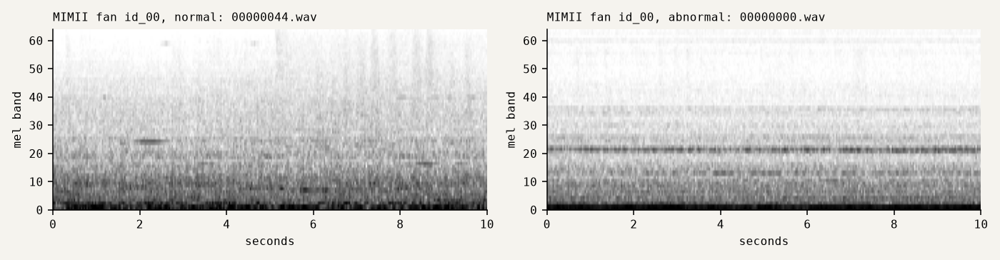

# Dhadkan



Listen: [blower, normal](docs/media/blower_normal.wav) · [same blower model, faulty](docs/media/blower_fault.wav)
(10 s each, MIMII dataset fan id_00, CC BY-SA 4.0)

**A small factory in India loses a day's output when a pump or blower seizes, and the owner had no
way to hear it coming.**

Dhadkan listens to each machine through a phone, flags a sound that is drifting away from that
machine's own normal, and sends the owner a short note a mechanic would write:

> ब्लोअर 1: बेयरिंग की आवाज़ 2 दिन से बढ़ रही है। मंगलवार से पहले जाँच करवा लें। रमेश को मंगलवार को भेजें? जवाब दें: हाँ / ना

When one owner confirms a fault ("खट-खट आ रही है"), its sound fingerprint (64 numbers, never audio)
goes to a shared registry. Machines of the same model in other factories are re-checked against it
and can be flagged before their own alarm trips. Nothing ever stops a machine: the owner replies
yes or no to a technician visit.

Built for Tech4Bharat problem statement 4.3 (machine failure prediction for small factories).

---

## Run it

```bash
make setup     # .venv (Python 3.12) + pip install, and npm ci for the web app
make data      # ~1 GB subset of MIMII + MIMII DUE, about 30 min (python -m data.download --small halves it)
make train     # 3 models -> edge/models/, evaluation -> docs/runs/eval_<UTC>.json (~2 min CPU)
make demo      # builds the web app, serves it with the API on :8600, starts the demo replay, opens it
```

The trained models and the evaluation record are committed, so `make setup && make demo` works
without `make data` / `make train` except for the audio replay itself, which needs the clips.

```bash
make test      # 103 tests: scoring, thresholds, registry, outbox, agent guardrails, forecast, live server
make lint      # ruff + black, eslint + prettier, tsc --strict; zero warnings
make dev       # API on :8600 + Vite with hot reload on :5173
python -m server.folk    # optional: Whisper check on the sample voice notes -> docs/runs/asr_<UTC>.json
python -m server.story   # the demo script without waiting -> docs/runs/story_<UTC>.json
```

Add `?debug` to the URL for frame rate and draw calls, and `?m=B-F1` to open a machine directly.

Everything runs offline after the downloads (datasets; the Whisper `small` model is fetched from
Hugging Face on first use). Only two things call the network, both optional and both need
`ANTHROPIC_API_KEY`: the agent's "Run (Claude)" button and the LLM fallback for sound words the
lexicon doesn't know. Without a key, "Run (rules)" calls the same tools in a fixed order.

The registry API on its own: `uvicorn server.registry_api:create_app --factory --port 8100`.

## Demo

`make demo` (or press **D**) starts the replay. A 90-second presenter script is in
[docs/DEMO.md](docs/DEMO.md); before/after screenshots are in [docs/screenshots](docs/screenshots).

**First it records 14 days** (about 8 s): 42 readings per machine, each a real 10 s MIMII clip scored
by the exported `.tflite` model, on a simulated clock (one reading every 8 h). From day 6, factory A's
blower (A-F1) develops a *synthetic* fault: its abnormal recording mixed into its normal one, 3%
stronger every reading. **Then it plays live**, one reading every 10 s, streamed at 2 Hz.

The screen has a top bar of big numbers (machines OK / watch / alert, rupees at risk in the next 2
days, the technician's next stop), a **Needs attention** list on the left (sorted by status, rupees
at risk and risk; click a row to fly to the machine), the 3D estate in the middle, and a right column
that slides in with the selected machine or a drawer. Nothing is drawn over the scene.

1. **0:00** 3 sheds in a row on one estate road, 12 machines. Each machine shakes with its live window
   score and ripples with the clip's loudness. Only machines near or at alarm get a glowing ring
   (amber near, orange at alarm or on a registry match); alerting machines also get a pulsing outline,
   a soft orange light and a label (name · fault · days to fault level).
2. **0:40** A-F1 becomes the recorded faulty machine itself: the simulated breakdown.
3. **0:50** the owner's Hindi voice note ("ब्लोअर में खट-खट की आवाज़ आ रही है") is transcribed by
   local Whisper; "khat-khat" maps to *bearing* through the lexicon (weak label).
4. **1:10** the fingerprint is published. Arcs go from A-F1 to every blower in the other sheds,
   labelled with the registry's real cosine against each machine's flag level. B-F1 (same blower
   model) then gets a *synthetic* fault onset.
5. When B-F1 matches in 2 of its last 3 readings, a dashed arc joins it to A-F1 and stays while the
   match holds, the rules agent plans the technician's day by rupees at risk, and the route draws
   itself on the road with numbered stops and arrival times.
6. Click B-F1 in the list: the right column opens with the owner's SMS (Marathi for factory B, Hindi
   for A) and an English line under it. **हो / Ho** books the visit and the technician's van drives
   the route.

The right column for a machine (click a row, or a machine in the scene):

- **Time machine.** A slider over the machine's last 14 days (arrow keys, Space to play). The 3D
  machine's shake, its ring, the spectrogram and every number rewind together to the chosen reading.
  The strip marks the **first warning** (first reading at alarm or registry match) and **breaks
  down** (the first reading that is the recorded faulty machine itself). What the owner said and what
  the registry matched later are hidden when you look at a day before they happened.
- **What changed in the sound.** For a flagged machine: the run of mel bands whose residual sits
  furthest above that machine's own normal, the change in measured band power since its earliest
  normal reading, a plain word for the pitch, a mechanic's rule of thumb (`server/sound_words.json`),
  and **Before / Now** 3-second clips of the same stretch.
- **Days to fault level.** A range ("likely 2.6-6.5 days") with a projected band: see below.
- **Live sound**: a scrolling spectrogram (the band that changed in orange), **Play live** and
  **Normal reference** (a held-out normal clip of the same unit), and the model's measured AUC for
  that machine type.

**Savings report (PDF)** (foot of the left list, the machine panel, or the phone list) gives the factory owner one page:
downtime avoided, emergency part markup avoided, idle wages saved, the visits it counts, what is at
risk now, and every assumption. It says on the page that the data is simulated and the costs are
assumptions. **Operator** has every step as a button, including **Run (Claude)** when
`ANTHROPIC_API_KEY` is set and the shed's signal switch; **Evaluation** shows the scores below;
**Log** lists every agent tool call; **?** explains the scene and lists the keyboard shortcuts.
Under 768 px wide the page is a 2D list with the same rings and never loads three.js. Camera moves
ease over 800 ms, then the view sways slowly (paused while you drag); the sheds rise in on load,
120 ms apart. With `prefers-reduced-motion`, nothing shakes, ripples, sways or tweens.

The estate is a schematic: the sheds stand side by side, while travel times use their real
distances. Belts and pulleys turn at **assumed** nameplate speeds (`nominal_rpm` in
`data/sim/cluster.json`), slowed down to be visible; MIMII gives no machine speeds.

### What the replay showed (one logged run, not a statistic)

From `python -m server.story` -> `docs/runs/story_20261115T154737Z.json`, which runs the same
replay script without waiting:

- **A-F1 was flagged 5.3 days before it broke down** (first alarm Thu 19 Nov 06:00; the recorded
  fault from Tue 24 Nov 14:00).
- **Days to fault level, checked against what happened:** 19 estimates were made between the first
  one and the breakdown; **12 of 19 ranges contained the real time**. The ranges were right in the
  first days and too long in the last day, because the scripted breakdown arrives as a jump (onset
  0.93 straight to the recorded fault) rather than a smooth rise.
- **B-F1 matched the published fingerprint at onset strength 0.2, five readings before its own
  alarm.**

### Days to fault level

The **fault level** of a machine is the median score, relative to its own alarm level, of its
recorded unit's *faulty* clips in the evaluation record (20 clips each). The estimate is a straight
line through the last 6 days of readings, projected to that level; the range is the 10th-90th
percentile of the crossing time over a residual bootstrap. A slope needs a t-statistic of 3 to count.

- These two settings were chosen on this demo's replay: with them, all 16 readings after A-F1's first
  warning carry an estimate and none of 195 readings of healthy machines does. On 5,000 simulated
  pure-noise series of 6 days, 0.42% got a false estimate (`tests/test_forecast.py` keeps it under 2%).
- **No estimate where the model can't separate faults:** pump id_02 and all three gearbox sections
  have recorded faults scoring 0.80-0.94 of their alarm level, below the alarm, so the page says so
  instead of counting down.
- MIMII has no run-to-failure recordings, and the growing faults in the demo are synthetic. This is an
  extrapolation of the machine's own trend, not a failure model.

**Rupees at risk** = the share of bootstrap trend lines that reach the fault level within 2 days x
the breakdown cost. The breakdown cost uses `data/sim/costs.json` (unplanned downtime hours, lost
output per hour, idle workers, wage, emergency part markup), which are **assumptions** a factory
replaces with its own numbers, and `data/sim/parts_mock.json` (mock prices). The agent's route
visits the stops with the most rupees at risk, with risk as the tie-break, and adds any machine that
may reach its fault level within 2 days.

### What changed in the sound: an honest example

For A-F1 the strongest change is a **low rumble (46-93 Hz) up 532%**, and the rule of thumb for that
band says "often a sign of imbalance or something loose", while the owner called it "khat-khat",
which the lexicon maps to bearing. MIMII does not say which fault each abnormal clip is (its fan
faults include imbalance, voltage change and clogging), so neither the rules nor the lexicon can be
checked on this data. The page shows both and labels the rule as a rule of thumb.

If the shed has no signal when the owner confirms, the fingerprint waits in the phone's outbox
(`edge/outbox.py`: SQLite, retried with backoff, idempotency key so a retry after a lost reply is
stored once) and goes out when the signal returns. **Operator → Shed signal** shows this.

## What is in here

```
edge/        the model, and what the phone runs
  features.py   audio -> 1.06 s log-mel windows (64 mels x 32 frames, 50% overlap)
  model.py      conv autoencoder (217k params) + TFLite export
  train.py      trains on NORMAL windows only, per-machine thresholds, AUC/pAUC, registry check
  scoring.py    reconstruction error, thresholds, AUC, DCASE pAUC
  runtime.py    the .tflite model + per-machine alarm levels, as the phone would run it
  embed.py      fault fingerprint: per-band residual, standardised per machine
  outbox.py     offline queue for fingerprints (exactly once, in order, survives restarts)
  models/       exported .tflite + meta.json per machine type
server/      API, registry and agent
  app.py        FastAPI + WebSocket for the web app, 2 Hz stream, demo replay script
  demo.py       `make demo` launcher
  registry.py   SQLite: fingerprints and weak labels (no audio column exists)
  registry_api.py  FastAPI: /fingerprints, /match, /labels/text, /labels/voice
  folk.py       Whisper (local) -> lexicon -> Claude fallback; lexicon.json is editable
  alerts.py     owner messages in Hindi / Marathi / English, yes/no reply parsing
  route.py      technician route: exact best-risk-within-hours, shortest order, ETAs
  agent.py      4 tools (none can control a machine), Claude tool loop or fixed-order rules, all logged
  sim.py        3 factories x 4 machines replaying real clips
  forecast.py   days to fault level: trend + bootstrap range; fault levels from the eval record
  costs.py      breakdown cost and savings from data/sim/costs.json (assumptions)
  explain.py    which band changed, by how much, in words; 3 s before/now clips (sound_words.json)
  report.py     the owner's one-page savings PDF
  story.py      runs the replay script without waiting and logs it (docs/runs/story_*.json)
web/         React + Vite + TypeScript, react-three-fiber + postprocessing (N8AO, outline); ~26 draw calls
             for the scene, ~65 per frame with the effect passes
data/        download.py (Zenodo range requests), sim/ (cluster, cost assumptions, mock parts, voice notes), raw/ (ignored)
docs/        DEMO.md, screenshots/ (before, after), media/, runs/ (every evaluation, ASR and story record cited here)
tests/       pytest
```

## Results

Every number below and on the dashboard comes from one evaluation record; regenerate both with
`make train && python -m edge.report`. Clip-level AUC/pAUC (pAUC = DCASE
definition, FPR <= 0.1). "false alarms / faults caught" use each machine's own alarm level.

From `docs/runs/eval_20261115T085722Z.json` (code sha256 a1b9d12adbbf, hashed over the model code
as it was then). The code has moved and changed since (`edge/runtime.py` also returns per-band
deviations and scores with 4 threads; files moved from `dhadkan/` into `edge/` and `server/`);
none of it changes how a clip is scored, and `tests/test_thresholds.py` checks the shipped
thresholds against this record.

| type | condition | AUC | pAUC | normal + anomalous | false alarms | faults caught |
|---|---|---|---|---|---|---|
| pump | -6dB (stress test) | 0.945 | 0.650 | 20 + 20 | 95% | 100% |
| pump | 6dB | 0.727 | 0.500 | 32 + 40 | 9% | 65% |
| fan | 6dB | 0.991 | 0.906 | 32 + 40 | 6% | 100% |
| gearbox | source | 0.659 | 0.058 | 60 + 60 | 10% | 12% |
| gearbox | target (stress test) | 0.579 | 0.067 | 30 + 30 | 10% | 20% |

| recorded unit | AUC | pAUC |
|---|---|---|
| pump/id_00 | 1.000 | 1.000 |
| pump/id_02 | 0.828 | 0.206 |
| fan/id_00 | 0.991 | 0.906 |
| fan/id_02 | 1.000 | 1.000 |
| gearbox/section_00 | 0.570 | 0.100 |
| gearbox/section_01 | 0.747 | 0.225 |
| gearbox/section_02 | 0.635 | 0.000 |

Registry, synthetic onset 0.25 (alarm / registry), registry false flags on normal clips:

| case | from | to | alarm | registry | false flags |
|---|---|---|---|---|---|
| same model | pump/id_00 | pump/id_00 | 100% | 100% | 0% |
| other unit | pump/id_00 | pump/id_02 | 0% | 6% | 0% |
| other unit | pump/id_02 | pump/id_00 | 94% | 25% | 0% |
| same model | pump/id_02 | pump/id_02 | 0% | 100% | 50% |
| same model | fan/id_00 | fan/id_00 | 12% | 75% | 0% |
| other unit | fan/id_00 | fan/id_02 | 0% | 0% | 25% |
| other unit | fan/id_02 | fan/id_00 | 0% | 38% | 6% |
| same model | fan/id_02 | fan/id_02 | 6% | 31% | 31% |
| same model | gearbox/section_00 | gearbox/section_00 | 0% | 31% | 25% |
| other unit | gearbox/section_00 | gearbox/section_01 | 0% | 0% | 0% |
| other unit | gearbox/section_00 | gearbox/section_02 | 30% | 35% | 30% |
| other unit | gearbox/section_01 | gearbox/section_00 | 15% | 10% | 20% |
| same model | gearbox/section_01 | gearbox/section_01 | 0% | 0% | 10% |
| other unit | gearbox/section_01 | gearbox/section_02 | 30% | 0% | 0% |
| other unit | gearbox/section_02 | gearbox/section_00 | 15% | 5% | 10% |
| other unit | gearbox/section_02 | gearbox/section_01 | 0% | 0% | 5% |
| same model | gearbox/section_02 | gearbox/section_02 | 25% | 6% | 20% |

What these numbers say:

- **Fan works; pump is uneven; gearbox is weak.** The pooled pump AUC (0.73) is lower than
  either pump unit's because the two units produce scores on different scales; that is why every
  machine gets its own alarm level. Gearbox (MIMII DUE) is near chance in places (section_02
  pAUC 0.000). We show it rather than drop it.
- **Noisy shed.** The same pump under louder factory noise (MIMII -6 dB) still ranks faults well
  (AUC 0.945), but with the alarm level set in the quieter recording, 95% of normal readings raise
  an alarm. Alarm levels have to be re-set after installing in a new shed.
- **Speed or load change.** The gearbox under changed operating conditions (DUE target domain)
  drops to AUC 0.579 and catches 20% of faults.
- **The registry helps only between machines of the same model.** On held-out clips of the same
  blower model, a 0.25-strength onset is flagged by the registry 75% of the time against 12% by the
  machine's own alarm, with 0/16 false flags. Across different units it mostly fails, and some
  same-model cases have high false-flag rates (pump id_02: 50%). "Same model" is approximated by
  disjoint clips of one recorded unit; we have no recordings of two identical machines.
- **Voice notes.** On our synthetic notes, Whisper-small labelled the Hindi note correctly in 3 of
  3 runs and the Marathi note in 1 of 3 (`docs/runs/asr_*.json`). Typed notes and the Claude fallback
  cover misses.

## Assumptions and limits

- **Data.** MIMII 6 dB pump and fan (units id_00, id_02), MIMII -6 dB pump id_00, MIMII DUE gearbox
  (sections 00-02). A small subset: 34 training clips per MIMII unit, 50 per gearbox section; test
  sets are 16-20 normal + 20 anomalous clips per unit, so each AUC has wide error bars.
- **Alarm level** = 95th percentile of each machine's held-out normal readings (so ~5% of healthy
  readings cross it by design). **Registry flag** = above the highest similarity the machine showed
  while healthy (99th percentile of its held-out normals), in 2 of the last 3 readings.
- **Synthetic fault onset.** MIMII has no recordings of a fault developing. Onset is an abnormal
  recording mixed into a normal one with power-preserving weights. It is labelled SYNTHETIC
  everywhere it appears.
- **Folk-sound lexicon weights** (`dhadkan/lexicon.json`) are our assumptions, not measurements.
  A label from an owner is a weak label, not an inspection. MIMII does not say which fault each
  abnormal clip is, so we cannot score the fault-class mapping.
- **Simulation.** Factory names, owners, phone numbers, locations, service hours (pump 1 h, fan
  0.75 h, gearbox 1.5 h), road speed (22 km/h) and the technician's 09:00 start are invented.
  Breakdown costs (`data/sim/costs.json`) are assumptions too, and so is every rupee on screen and in
  the savings PDF. The looms and the flour mill replay MIMII DUE gearbox recordings, standing in for their gear
  drives; the 3D shapes are only pictures. Voice notes are macOS
  text-to-speech, not real owners. Dealer parts and prices are mock data.
- **Phone.** We export a 256 KB `.tflite` (dynamic-range int8 weights) and check it scores within
  0.2% of the Keras model; the log-mel front end to re-implement on Android is in
  `edge/models/frontend.json`. We did not build the Android app.
- **Agent.** It has four tools (risk ranking, route, owner message, parts quote) and no tool that
  can control a machine. Owner text only comes from reviewed templates. It does not repeat a
  question while one is open or a visit is already approved. Model: `claude-opus-5-5` with
  server-side fallback (`fallbacks: "default"`).

## Data credits

- Purohit et al., "MIMII Dataset: Sound Dataset for Malfunctioning Industrial Machine
  Investigation and Inspection", DCASE 2019. https://zenodo.org/records/3384388 (CC BY-SA 4.0)
- Tanabe et al., "MIMII DUE: Sound Dataset for Malfunctioning Industrial Machine Investigation
  and Inspection with Domain Shifts", 2021. https://zenodo.org/records/4740355 (CC BY-SA 4.0)

The clips in `docs/media/` are unmodified channel-0 extracts from MIMII and keep its CC BY-SA 4.0 license.
