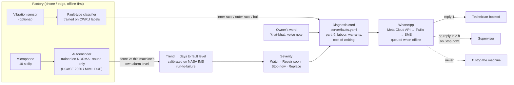

# Dhadkan

**Small Indian factories (powerlooms, flour mills, pumps) run old machines until they break. Dhadkan
uses a phone to hear failures coming, tells the owner on WhatsApp in their language, gets the right
repair done, and proves it worked.**

Monitoring exists for big plants with costly sensors. Nothing serves a small shed with a phone, in
the owner's language, and nothing checks that the repair actually worked.


*60 seconds of `make demo` → **Demo mode**. The fault that grows is a real bearing failing on the
NASA IMS test rig, not a simulation. Regenerate the GIF with `python -m tools.demo_gif`.*

Built for Tech4Bharat problem statement 4.3 (machine failure prediction for small factories).

The owner receives:

> बंद करने का सोचिए · लूम 1 – मोटर का बेयरिंग घिस रहा है। 2 दिन से आवाज़ बढ़ रही है। अभी ठीक हो सकता है:
> बेयरिंग 6205 (पुराने जैसा नंबर), ~₹315-680, 1-2 घंटा। 1.5 दिन से ज़्यादा चलाया तो मोटर जल सकती है
> (~₹2,000)। जवाब दें: 1 = मिस्त्री बुलाओ, 2 = बाद में, 3 = पूरी जानकारी। (अनुमानित दाम और वारंटी, डीलर से पक्का करें।)

*(Output of `server/diagnosis.py`. Inputs: bearing wear, 2 HP motor, estimate 1.5–5 days to fault
level, rising for 2 days. The English version reads "Consider stopping it · Loom 1 – The ball bearing in the
motor is wearing out … Reply 1 = send mechanic, 2 = later, 3 = details. (Typical prices and
warranty, confirm with dealer.)")*

Every word comes from `server/faults.yaml`, not from a language model. The price is the cited part
range plus labour at an assumed rate. "Consider stopping it" is advice to the owner: **Dhadkan never stops a
machine**, and only a reply of **1** books the technician.

---

## How it works



1. **Listen.** One conv autoencoder per machine type learns what *normal* sounds like. It never sees
   a fault in training. A clip's score is its reconstruction error relative to that machine's own
   alarm level (1.0 = alarm).
2. **Trend.** The score's recent trend is projected to the level at which real bearings reached
   failure on the NASA IMS rig. The output is a range ("likely 2–5 days"), or no estimate when the
   trend is not significant.
3. **Name it.** With a vibration sensor, a random forest trained only on CWRU's labelled bearing
   faults says inner race, outer race or ball. Without one, the owner's word for the sound
   ("khat-khat", "seeti") picks the fault. The card says which source named it.
4. **Diagnose.** `server/faults.yaml` covers seven faults: bearing wear, misalignment, imbalance,
   belt slip, cavitation, motor winding and looseness. Each entry has:
   - a plain explanation in Hindi, Marathi and English
   - whether it is repairable, and why
   - the part, a typical ₹ range with its source, labour hours and technician type
   - misuse causes, warranty and what voids it

   Severity (Watch / Repair soon / Stop now / Beyond repair) comes from the score trend and the
   days range. The cost of waiting vs fixing now comes from the factory's cost profile.
5. **Tell the owner.** A WhatsApp message goes out in the owner's language, with a 5 s before/now
   audio clip and a spectrogram.
   - **1** books the technician, **2** means later, **3** sends the full card.
   - A Stop-now alert with no reply in 2 h goes to the supervisor.
   - With no network, alerts queue, fall back to SMS, and send when the network returns.

### Beyond the alert

- **Understand:** when neither the vibration classifier nor the owner names the fault, Claude Fable 5.2
  looks at the spectrograms, trend and profile ([server/understand.py](server/understand.py)). It
  returns a fault, confidence, evidence and a hand check ("motor ka end garam hai?"). Prices still come
  from faults.yaml. Unsure → "mechanic check needed". No key or offline → rules, "expert check pending".
- **Fix:** "Mechanic bulao" sends the owner's own mechanic a job: machine, fault, part to bring, time,
  dealer stock ([server/fix.py](server/fix.py)). It is refused in code without the owner's logged
  approval. A weekly parts forecast counts machines per part and area.
- **Prove:** after the repair, a 60 s re-record says Theek ho gaya / Aadha theek / Repair kaam nahi
  aaya ([server/prove.py](server/prove.py)). The repair record is signed (Ed25519) as a PDF for
  warranty. A machine health passport (grade A–D, numbers only) can be shared for a sale or a loan.
- **Setup:** an owner sends "Namaste" on WhatsApp and answers a few questions in their language
  (factory type, machines, shifts, power cuts, contacts). Then 30 s per machine starts its learning
  period ([server/onboard.py](server/onboard.py), [data/presets.yaml](data/presets.yaml)).
- **Screens:** `?view=owner&f=A&lang=hi` (owner, phone, white, big Devanagari),
  `?view=mechanic&f=A` (visits, parts, history), and the 3D cluster screen.
- Languages: Hindi, Marathi, Gujarati, English and Hindi in Roman script. Alert timing respects quiet
  hours and power cuts; watch-level alerts go into one daily digest.

More in [docs/ARCHITECTURE.md](docs/ARCHITECTURE.md) and [docs/JUDGES.md](docs/JUDGES.md).

## Run it

```bash
make setup     # .venv (Python 3.12) + pip, npm ci
make data      # real data: DCASE 2020 Task 2 dev, NASA IMS, CWRU, MIMII DUE gearbox (see "Limitations" for the subset)
make train     # anomaly models, CWRU fault classifier, IMS calibration, docs/RESULTS.md
make demo      # web app + API on :8600, opens the browser
```

Trained models and evaluation records are committed, so `make setup && make demo` runs without
`make data` and `make train`, except the audio and vibration replay, which reads the raw files.

**Demo mode** (button in the top bar):
1. It replays NASA IMS test 2, bearing 1 as Loom 1's motor bearing. That bearing failed on the outer
   race in February 2004 after about 7 days.
2. When the health score crosses the alarm, the CWRU classifier names the fault from the real
   vibration.
3. The alert goes to the WhatsApp number typed into the box.

To send for real, copy `.env.example` to `.env` and fill in one provider:

| provider | keys | note |
|---|---|---|
| Meta WhatsApp Cloud API | `WA_TOKEN`, `WA_PHONE_NUMBER_ID`, `WA_APP_SECRET`, `WA_VERIFY_TOKEN` | free test number; it reaches only the numbers registered on it |
| Twilio WhatsApp Sandbox | `TWILIO_ACCOUNT_SID`, `TWILIO_AUTH_TOKEN` | the judge first sends the sandbox join code; media needs `PUBLIC_BASE_URL` |
| Twilio SMS (fallback) | `TWILIO_SMS_FROM` | used when WhatsApp fails |

With no keys, every message is built, logged and shown as **dry run**: nothing is sent, and the UI
says so. Reply webhooks:
- `/webhooks/whatsapp` (Meta): GET verify, POST signed with `X-Hub-Signature-256`
- `/webhooks/twilio`: signed with `X-Twilio-Signature`

Badly signed replies are rejected.

```bash
make test      # pytest: faults.yaml schema, severity mapping, WhatsApp payloads + webhooks, no-stop guardrail, offline queue, …
make lint      # ruff + black, eslint + prettier + tsc; zero warnings
make results   # regenerate docs/RESULTS.md and the summary below from docs/runs/
```

## Results

Full tables, failure cases and the DCASE baseline comparison are in [docs/RESULTS.md](docs/RESULTS.md).
The summary below is written by `python -m edge.results` from the records in `docs/runs/`.

<!-- results:start -->
| what | measured | compared with |
|---|---|---|
| fan: fault vs normal sound (DCASE 2020 official test split) | AUC 55.3% · pAUC 51.2% | DCASE baseline 65.83% · 52.45% |
| pump: fault vs normal sound (DCASE 2020 official test split) | AUC 63.7% · pAUC 56.3% | DCASE baseline 72.89% · 59.99% |
| slider: fault vs normal sound (DCASE 2020 official test split) | AUC 78.3% · pAUC 62.3% | DCASE baseline 84.76% · 66.53% |
| valve: fault vs normal sound (DCASE 2020 official test split) | AUC 54.1% · pAUC 50.6% | DCASE baseline 66.28% · 50.98% |
| loudness (RMS) threshold vs our autoencoder, same test clips | RMS has the higher AUC on 15 of 19 units | failure case |
| gearbox (MIMII DUE, source domain) | AUC 65.9% · pAUC 50.4% | – |
| fault type, CWRU bearing load never seen in training | accuracy 93.0% (mean of 4 loads) | 4 classes |
| fault type, CWRU fault size never seen (0.028 in) | accuracy 48.0% | failure case |
| NASA IMS 1st_test/b3 (inner race) | alarm 25.97 days before the end; 56/113 calibrated day ranges held the real remaining time | classifier said ball |
| NASA IMS 1st_test/b4 (ball) | alarm 25.97 days before the end; 142/163 calibrated day ranges held the real remaining time | classifier said ball |
| NASA IMS 2nd_test/b1 (outer race) | alarm 3.13 days before the end; 68/106 calibrated day ranges held the real remaining time | classifier said outer race |
| NASA IMS 3rd_test/b3 (outer race) | alarm 35.27 days before the end; 135/158 calibrated day ranges held the real remaining time | classifier said inner race |
| NASA IMS 2nd_test/b2 (did not fail) | 33.1% of readings at alarm | false alarms |
| NASA IMS 2nd_test/b3 (did not fail) | 82.7% of readings at alarm | false alarms |
| NASA IMS 2nd_test/b4 (did not fail) | 45.4% of readings at alarm | false alarms |

*Generated by `python -m edge.results`; details and sources in docs/RESULTS.md.*
<!-- results:end -->

## What doesn't work yet

- **Microphone ≠ vibration.** The fault-type classifier works on vibration (CWRU, IMS). It does not
  apply to phone audio. From sound alone, the owner's word names the fault, which is a weak label.
- **Classifier transfer is partial.** It was trained on one bearing (SKF 6205, 12 kHz) and applied
  to another (Rexnord ZA-2115, 20 kHz) through geometry-normalised defect orders. It fails on a CWRU
  fault size it never saw (see RESULTS.md).
- **Four failures.** NASA IMS has four run-to-failure bearings. The failure level and trend window
  are chosen leave-one-out, but that is still only four cases. Days-to-failure is an extrapolation of
  the trend, not a physical wear model.
- **DCASE training subset.** Bandwidth limited training to the first 100 normal clips per machine ID
  (about a tenth of the official train split). Evaluation uses the full official test split.
- **Sound-only detection is weak for fan and valve.** On the official split they are near chance, and
  every machine type is below the DCASE baseline on most IDs (table above). So in the scripted MIMII
  replay (the **Demo** switch), the "faulty" blower is never warned about, and the alarms that fire are
  healthy machines crossing their alarm level, about 1 reading in 10 by design. **Demo mode** (the
  NASA IMS bearing) is the replay where the score really climbs to failure.
- **Prices and warranties** in `faults.yaml` are typical listed prices from cited Indian sources,
  accessed 2026-11-16. They are not quotes. Labour hours have no published source (`source: null`).
  Downtime cost, output per hour and the technician rate (`data/sim/costs.json`) are **assumptions**
  that a factory replaces with its own numbers.
- **Simulation.** Factories, owners, phone numbers and locations in `data/sim/cluster.json` are
  invented, and those numbers are never messaged. Growing faults on the machines other than the
  Demo-mode loom are synthetic mixes of real recordings, labelled SYNTHETIC on screen.
- **A loudness threshold beats our autoencoder** on most units of the official split (RESULTS.md 1b).
  We haven't switched detectors: that needs fresh field data, not the test split we already looked at.
- **No Android app.** The `.tflite` is exported and timed on a laptop CPU. Phone speed and battery are
  not measured.
- **No real WhatsApp message has been sent.** No keys are configured; templates still need Meta
  approval (docs/WHATSAPP_TEMPLATES.md). Spoken (voice) alerts are not built.
- **Claude's diagnosis is not evaluated:** `scripts/eval_understand.py` needs an API key.
- **No field recordings and no owner interviews yet.** Every factory, owner and phone number in the
  demo is invented. `scripts/score_recording.py` and docs/FIELD_NOTES.md are ready for the first visit.
- **The agent** has four tools: risk ranking, route, owner message and parts quote. None can control
  a machine (`tests/test_guardrails.py`).

## What is in here

```
data/     real.py (DCASE 2020, NASA IMS, CWRU, demo subset), download.py (MIMII DUE gearbox), presets.yaml, sim/ (assumptions)
edge/     features, autoencoder + TFLite, train.py, adapt.py (learning, drift, noisy shed), listen_eval.py (RMS baseline,
          edge cost), faulttype.py (CWRU), ims.py (run-to-failure + demo pack), results.py
server/   app.py, faults.yaml + diagnosis.py, understand.py (Claude), owner_alerts.py, notify/ (WhatsApp, SMS, policy,
          queue, media), fix.py, prove.py, onboard.py, forecast.py, imsdemo.py, agent.py, folk.py, registry.py, route.py
web/      React + Vite + react-three-fiber: 3D cluster screen, owner and mechanic phone screens, Demo mode
scripts/  eval_understand.py (Claude vs rules), score_recording.py (field recordings)
tools/    demo_gif.py
docs/     JUDGES.md, ARCHITECTURE.md, RESULTS.md (generated), PITCH.md, DEMO_SCRIPT.md, WHATSAPP_TEMPLATES.md,
          FIELD_NOTES.md, runs/ (every evaluation record cited anywhere)
tests/    pytest
```

## Data credits

- DCASE 2020 Task 2 development dataset (MIMII and ToyADMOS subsets), Koizumi et al., Purohit et al.:
  https://zenodo.org/records/3678171 (CC BY-SA 4.0). Baseline numbers from
  https://dcase.community/challenge2020/task-unsupervised-detection-of-anomalous-sounds
- MIMII DUE (DCASE 2021 Task 2 dev), Tanabe et al.: https://zenodo.org/records/4740355 (CC BY-SA 4.0)
- NASA IMS bearing dataset: J. Lee, H. Qiu, G. Yu, J. Lin, Rexnord Technical Services, IMS,
  University of Cincinnati; NASA Prognostics Data Repository.
- CWRU Bearing Data Center, Case Western Reserve University: https://engineering.case.edu/bearingdatacenter
- Price and warranty sources: listed per entry in `server/faults.yaml`.

The clips in `docs/media/` are unmodified channel-0 extracts from MIMII (CC BY-SA 4.0).
