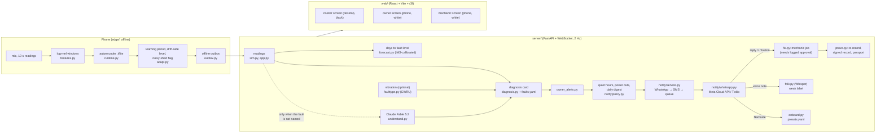
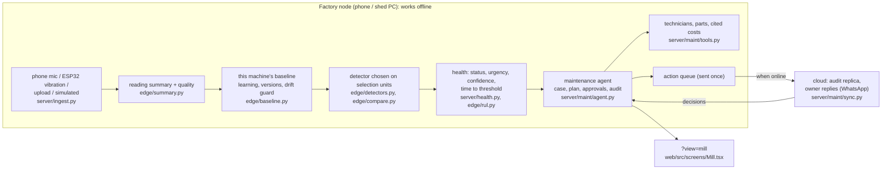
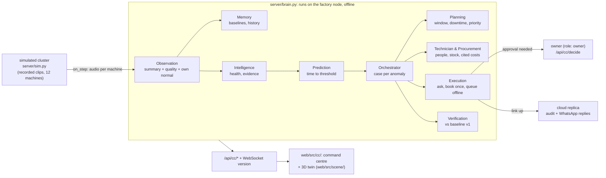

# Architecture

Five stages: **Listen → Understand → Tell → Fix → Prove**. Each one works without the next. The owner
makes every decision, and **no code path can stop a machine** (`tests/test_guardrails.py`).

## Modules

| stage | module | does | needs |
|---|---|---|---|
| Listen | `edge/features.py`, `edge/model.py`, `edge/train.py` | log-mel windows, conv autoencoder trained on normal sound only, TFLite export, evaluation | DCASE 2020 / MIMII DUE |
| | `edge/runtime.py` | the `.tflite` as the phone runs it: score, per-band deviation, fingerprint | |
| | `edge/adapt.py` | learning period, alarm level, drift-safe adaptation, noisy-shed flag | |
| | `edge/listen_eval.py` | RMS-threshold baseline, edge cost (size, ms) | |
| | `edge/ims.py`, `edge/faulttype.py` | NASA IMS run-to-failure calibration; CWRU fault-type classifier | IMS, CWRU |
| Understand | `server/diagnosis.py`, `server/faults.yaml` | severity rules and the diagnosis card; every ₹, part and warranty value is cited here | |
| | `server/understand.py` | Claude Fable 5.2 second look (JSON schema, effort high, fallbacks, caching, cost log) | `ANTHROPIC_API_KEY` (optional) |
| | `server/folk.py` | owner's words / voice notes → weak label (local Whisper, lexicon, Claude for unknown words) | |
| Tell | `server/owner_alerts.py` | builds the alert from the card, media, sends; replies, voice notes, onboarding | |
| | `server/notify/policy.py` | quiet hours, power cuts, daily digest, templates, buttons | |
| | `server/notify/service.py` | alert log, outbox, WhatsApp → SMS fallback, escalation after 2 h, release of held alerts | |
| | `server/notify/whatsapp.py` | Meta Cloud API and Twilio providers, signed webhooks, media download | keys in `.env` |
| Fix | `server/fix.py` | mechanic job (refused without logged approval), parts forecast, dealer batch | |
| Prove | `server/prove.py` | repair verification, Ed25519-signed record (PDF), health passport, owner-only mechanic stats | `keys/` (auto-created) |
| Setup | `server/onboard.py`, `data/presets.yaml` | WhatsApp onboarding, presets, factory profile, baseline clips | |
| Demo | `server/sim.py`, `server/imsdemo.py`, `server/agent.py`, `server/route.py` | 3 simulated factories replaying real recordings; Demo mode (NASA IMS); route planning | |

## Per-machine learning and the maintenance agent (PS 4.3 pass, 2026-11-16)

| module | does |
|---|---|
| `edge/summary.py` | one reading → 254 numbers (loudness, mel band statistics, MFCC) + quality (clipped, dropout, too short); never audio |
| `edge/detectors.py` | RMS, spectral shape, transient, MFCC-Mahalanobis, Isolation Forest, calibrated autoencoder; each fitted on one machine's normal readings, out-of-fold calibrated; explanation of what changed |
| `edge/compare.py` | chooses the detector on selection units, reports on held-out units |
| `edge/baseline.py` | per machine: learning period, baseline versions, readings never learned (high, during a case, after a restart, off, unusable), small drift adapts only if clear anomalies stay flagged, large drift needs the owner |
| `edge/rul.py` | time to the maintenance threshold with a calibrated range; explicit insufficient-data, no-trend and at-threshold states; IMS leave-one-out evaluation |
| `server/health.py` | readings → status, urgency (monitor, measure again, inspect, maintenance, urgent owner attention), confidence with named reasons, plain-word evidence, next check |
| `server/maint/store.py` | the agent's memory: machines, cases, steps, idempotent actions, approvals, repairs, hash-chained audit |
| `server/maint/agent.py` | one case per anomaly; steps persisted (restart resumes); gated paid actions; recovery from network, provider, technician and crash failures; verification against baseline v1 |
| `server/maint/sync.py` | idempotent push of the audit chain (tampering refused), pull of the owner's WhatsApp decisions, first-decision-wins conflicts asked again |
| `server/maint/evaluate.py` | 200 randomised fault-injection runs of the workflow |
| `server/flourmill.py`, `server/mill_api.py` | the end-to-end story on recorded readings; `/api/mill/*` |
| `server/ingest.py`, `hardware/`, `tools/sim_device.py` | device readings labelled live / upload / simulated, idempotent per device sequence number |

Guardrails added in this pass (tested): `book_job` and `order_part` refuse without an approved
approval of the right kind for the same case, checked when created and again when sent; questions
expire when a case closes; a stop is only ever a question to the owner, whose answer is logged.

## The 3D digital twin (web/src/scene/, 2026-11-16)

Every 3D machine is keyed by the backend's machine id (`/api/state` → `machines[].id`) and drawn from
these fields only:

| visual | backend field | rule |
|---|---|---|
| ring colour | `status`, `operating` | green normal, amber watch, orange alert (alarm or registry match), dashed grey stopped / no signal / no reading, blue-grey learning (`theme.twinState`) |
| ring fill | `risk3` | share of its own alarm level, on watch and alert |
| ring pulse | state | faint breathing (normal), gentle wave (watch), stronger wave every 1.6 s (alert), none (offline) |
| pulleys, fans, impellers, belts, mill feeder | `operating.running` | turn at the type's assumed nameplate rpm; a confirmed stop (`running: false`) spins them down over ~2 s; a lost sensor (`running: null`) keeps the last known state and the label says "no signal · last HH:MM" |
| shake | live frame `risk` | only while running; no live frame for a stopped or silent machine |
| sound ripples | live frame `energy` | only from live readings |
| sensor LED | `operating.sensor`, `latest.tick` | green with a flash on each new reading; dim when nothing new (stopped); dark when lost |
| gateway LED (per bay) | `link.up` | green; amber blinking while the link is down and readings wait in the outbox |
| conveyor | `operating.running` of the bay's machines | runs while any machine in the bay runs |
| labels | `name`, `twinWords` | risk as "0.89× alarm", never a health %; "simulated" when a demo control set the state |

Stopped vs lost sensor: both produce no new reading (`server/sim.py` skips them), and the live 2 Hz frame
stream drops them (`Live._analyse`), so no old reading is ever streamed as live. `POST
/api/machine/{id}/operating` is the SIMULATED control behind the panel's *Simulate* buttons; every state it
sets is flagged `simulated` until restored. There is no temperature sensor in Dhadkan, so none is shown.

Camera: left drag rotates, right drag pans, the wheel zooms (OrbitControls with damping); click flies to a
machine, double click flies closer, *Whole factory view* (or Esc) returns. A slow sway runs only after 8 s
without input, and the factory never spins. Rendering: one instanced mesh per part type (76 draw calls,
~73k triangles for 3 bays and 12 machines); `PerformanceMonitor` lowers the pixel ratio, then ambient
occlusion, if the frame rate falls. Measured 54-57 fps on this Mac with and without a 4x CPU throttle
(`?debug`); not measured on a low-end laptop.

## Command centre and agents (2026-11-16)

- **Agents are code with responsibilities, not messages.** `server/agents.py` names them, maps every
  orchestrator step to the agent that owns it (`STEP_AGENT`), and records each run (task, status, observation,
  tools, one-line reasoning from the step's own result, result, retries) in `agent_runs` beside the cases, and
  in the hash-chained audit log. Observation, intelligence and prediction record one run per reading cycle.
- **Persistence:** `data/brain_edge.db` (readings and baselines), `data/brain_maint.db` (cases, steps,
  idempotent actions, approvals, repairs, agent runs, op log, audit), `data/brain_cloud.db` (replica). A
  restart resumes open cases where they stopped (`tests/test_command_centre.py`). On first start against an
  existing cluster the memory agent learns each machine's normal from its recorded history.
- **Safety:** no tool stops a machine; bookings and purchases need an approved approval for the same case,
  checked when created and when sent; `/api/cc/decide` needs the owner role (`server/auth.py`; demo mode when
  no tokens are configured, and the UI says "demo login").
- **Offline:** everything above runs locally; only the cloud replica and outward messages need the link
  (the top-bar switch simulates a cut). Messages queue and go out once.
- **Local vs cloud:** local: readings, baselines, health, agents, cases, approvals. Cloud: the audit copy and
  the owner's WhatsApp replies. No step needs an LLM.
- **UI:** `web/src/cc/` (data contract `data.ts`, panels, pages, machine detail); the 3D twin is
  `web/src/scene/` with machine states mapped from the agents' health (`withHealth`). The earlier cluster screen
  is `?view=cluster`.

## Data and state

- **Committed:** trained `.tflite` models and per-machine thresholds (`edge/models/`), the IMS demo pack, every evaluation
  record cited anywhere (`docs/runs/`), the knowledge base, presets and simulation configs (all assumptions labelled).
- **Downloaded, git-ignored:** datasets (`data/raw/`, `make data` or `make demo-data`).
- **Local state, git-ignored:** SQLite `data/node.db` (readings, messages, alerts, repair records), registry, outbox,
  `data/alerts/` (alert media), `data/factories/` (onboarded profiles and baseline clips), `data/labels/` (verified
  repairs), `data/llm/` (Claude call log), `runs/field/` (field scores), `keys/` (signing key), `.env` (API keys).
- **Never stored or shared:** raw audio outside the factory's own computer. The registry holds 64-number fingerprints,
  and the passport holds numbers only.

## Guardrails (enforced in code, tested)

1. No tool, endpoint or reply can stop or control a machine.
2. No outward action without the owner's logged approval: the mechanic's job is refused without `messages.approved = 1`.
3. Only reply `1` (or button 1) books; everything else is logged.
4. Prices, parts and warranty come from `faults.yaml` with sources, marked "typical, confirm with dealer". Claude never
   writes a number on the card.
5. Keys only in `.env`; the recorder and rehearsals can force a dry run (`DHADKAN_DRY_RUN=1`).
